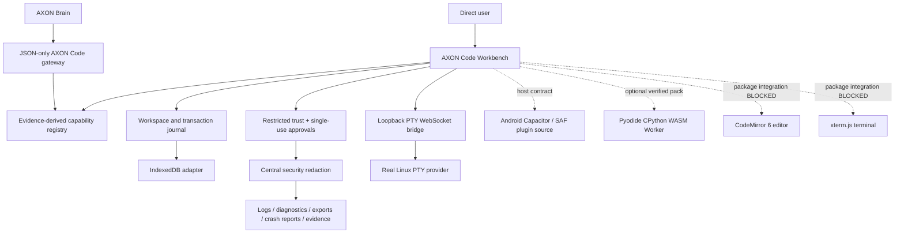

# AXON Code — Round 14 implementation report and checkpoint

**Status: FULL SOURCE CHECKPOINT — NOT FINAL / NOT DIRECTOR-APPROVED.** This archive contains the complete current AXON Code source tree and all work completed in this session. It is not proof that every Director requirement is complete. The AXON main app was not modified.

## 1. Baseline identity and §2.1 freeze

- Baseline: `AXON_CODE_v1_0_ROUND12_BUILD (1).zip`
- SHA-256: `f0482b17075b779481d19b1c815215af698eccbdb9e3e16413f58c54fef2becd`
- ZIP integrity: PASS; 425 archive entries.
- Historical SHA-256 manifest: 424/424 entries verified; zero mismatches.
- Baseline source and tests were retained; no existing source/test files were deleted or renamed.
- 158 historical reports remain under `docs/history/`.

**§2.1 result: PASS for archive identity and content integrity.** The actual Round 12 ZIP was present and extracted. This is not a claim that all Round 12 capabilities were complete. The original PTY was not connected to the UI and real IndexedDB reload durability was not proven by the baseline browser harness.

## 2. Director correction status

| Correction | State | What is actually delivered / remaining |
|---|---|---|
| C1 — reproducible packaging | **BLOCKED** | Exact TypeScript 5.8.3 devDependency and package-lock exist. `npm ci --offline` fails `ENOTCACHED`; online request fails DNS resolution for `registry.npmjs.org`. No clean install or verified tarball integrity is claimed. |
| C2 — PTY bridge | **DONE** | PTY exit/signal handling, environment allow-list and hardened loopback WebSocket bridge tested against a real Linux PTY. |
| C3 — Android provider | **PARTIAL / T3** | TypeScript host contract, Kotlin Capacitor SAF plugin source and fake-host contract tests added. Android compilation, plugin registration, persisted grants and device I/O are NOT RUN. |
| C4 — Pyodide Python | **PARTIAL / BLOCKED** | Real Pyodide CPython Worker adapter, SHA-256-verified offline pack contract, optional install/removal interface, bounds and cancellation added. No actual Pyodide assets are available; real Python execution is BLOCKED, not imitated. |
| C5 — editor and terminal engines | **BLOCKED** | Fixed choices: CodeMirror 6 and xterm.js; strict adapters reject textarea/fake-terminal fallbacks. Actual packages, lock entries with verified integrity, UI migration and xterm-to-PTY connection are blocked by registry DNS/package absence. |
| C6 — placement and budget | **DONE for current tree** | Historical reports retained under `docs/history`; merge set excludes history, `dist/` and `node_modules/`. Current manifest and merge-set checks are recorded by verifier. |
| C7 — evidence-derived registry | **DONE** | Registry generated only from machine-readable `results/*.json`. |
| C8 — test ratchet | **DONE for current tests** | Ratchet floor remains 1,015. All current Round 14 work-package suites pass; negative tests and mutants are included. |
| C9 — Director verification | **PARTIAL** | `verify:director` and `verify:browser` commands exist. Browser checks report 2 PASS, 1 NOT RUN, 0 FAIL. Director command remains BLOCKED by C1 clean-install evidence. |
| C10 — trust, approvals and secrets | **DONE for stated C10 scope** | Unknown projects remain Restricted by default; exact-request/project/action single-use approvals and replay/tampering/cross-project/expiry refusals are tested. Central redaction boundary covers structured logs, diagnostics, diagnostic exports and crash reports; project exports and execution/evidence paths also redact. Archive attack tests remain green. |

## 3. Why reproducible packaging is blocked

This is an observed environment limitation, not a source-code compilation error:

1. `npm ci --ignore-scripts --no-audit --no-fund --offline` exited 1 with `ENOTCACHED`: the TypeScript 5.8.3 tarball has no cached response.
2. `curl -I --max-time 8 https://registry.npmjs.org/typescript/-/typescript-5.8.3.tgz` exited 6 with `Could not resolve host: registry.npmjs.org`.
3. The lockfile has the exact TypeScript version and resolved tarball URL but no verified `integrity` hash. The global TypeScript 5.8.3 installation is available and is linked locally for build/test work; it is not a substitute for the locked npm artifact.
4. The failed offline `npm ci` removed the local link; it was restored to the host-global TypeScript 5.8.3 package so the source tree remains buildable. This restoration is not presented as a successful install.

Therefore a clean extraction → `npm ci` → build → tests proof cannot be made in this session. I will not invent a tarball hash or mark C1 complete. The same registry limitation blocks acquiring CodeMirror 6 and xterm.js and prevents generating trustworthy complete lock entries for those packages.

## 4. Implemented security and host-provider work

### 4.1 C10 / WP5 security

- Unknown workspaces resolve to `RESTRICTED`; read/edit remain possible while protected actions require approval.
- Approval tokens are one-use and bound to project fingerprint, action, exact canonical request SHA-256, explicit approval reference and expiry.
- Replays, expired approvals, cross-project/action use and request tampering are rejected.
- `src/security/securityArtifactRedaction.ts` supplies redaction helpers for diagnostics, diagnostic exports, structured logs and crash reports.
- `src/security/safeTelemetry.ts` is the persistence boundary for log, diagnostic and crash-report sinks; raw payloads are redacted before they reach the sink.
- Diagnostic analyzers, project export, execution output/errors and evidence summaries use redaction.
- Redaction corpus covers provider tokens, bearer credentials, AWS-style access keys, credential-bearing URLs, secret-bearing object keys and private-key blocks.
- New C10 security-completion suite: 7/7 PASS; existing trust/security suites: 24/24 PASS. Combined WP5 suite: 31/31 PASS.
- **Separate WP5 gap:** per-provider isolation grades and OS-enforced CPU, memory, process-count, disk and network quotas remain incomplete. No claim of sandbox enforcement is made from TypeScript wrappers.

### 4.2 C3 Android provider source

- `src/runtime/androidHostProvider.ts` defines the Android capability, SAF grant, child listing, bounded read/write and grant release contracts.
- `android/src/main/java/com/axoncode/host/AxonCodeHostPlugin.kt` provides Kotlin Capacitor plugin source for API/ABI reporting, SAF tree selection, persistable grant, child-document listing, scoped document read/write and grant release.
- The plugin advertises process/Python/Gradle providers as unavailable; it does not pretend those exist.
- Fake-host contract suite: 8/8 PASS, including malformed capability, below-API-floor, missing grant, size mismatch and oversize refusal tests.
- **NOT RUN:** Kotlin/Gradle compile, Capacitor registration, Android SAF persistence across process restart, device read/write, Android PTY/native Python/Gradle/APK and physical-device conformance. Fake-host results are contract evidence only, not Android provider evidence.

### 4.3 C4 Pyodide CPython WebAssembly Worker

- `src/runtime/pyodideWorkerProvider.ts` defines a distinct real Pyodide CPython runtime adapter using `loadPyodide` and `runPythonAsync` in a Worker.
- Offline pack verification checks required runtime assets, safe relative paths, byte sizes and SHA-256 hashes. A host-provided optional pack store can install and remove a verified pack.
- Requests are bounded by Python source size, timeout, output size, project-read-only file access and network-denied policy; cancellation/timeout terminates the Worker.
- Isolation is explicitly **Grade 1 Worker isolation**, not an OS sandbox.
- Contract suite: 8/8 PASS, including tampered/missing pack, refusal without pack, install/removal and deliberate mutant checks.
- **BLOCKED / NOT RUN:** no real Pyodide distribution is present in the project or npm cache. The registry cannot be resolved. Real CPython execution, package imports, offline restart, browser compatibility and Android WebView performance are NOT RUN. No interpreter imitation or network fallback exists.

### 4.4 C5 CodeMirror 6 and xterm.js

- The selected editor engine is CodeMirror 6; Monaco is not used.
- The terminal emulator choice is xterm.js with its fit addon.
- `src/workbench/editorEngineContracts.ts` defines strict host contracts. Missing CodeMirror mount or xterm/fit modules are rejected; no plain textarea or fake terminal is accepted as a final integration.
- Contract tests: 4/4 PASS.
- `docs/C5_ENGINE_ADOPTION.md` records the implementation boundary and required next steps.
- **BLOCKED:** the actual packages are absent from the local npm cache and registry DNS fails. The UI still uses the Round 12 textarea; xterm is not connected to the PTY. No package versions or integrity hashes were fabricated. Real engine integration and mobile performance remain NOT RUN.

## 5. Test results

| Command | Result | Evidence boundary |
|---|---:|---|
| `npm run build` | PASS | Host-global TypeScript 5.8.3 linked locally; not clean npm install. |
| `npm run test:r14:phase-a` | PASS | WP0 10/10, WP1 10/10, WP2 10/10, WP3 12/12, WP4 8/8, WP5 31/31, WP12 12/12; PTY WebSocket tests pass. |
| `npm run test:full-r14` (runs each of the 31 Node test files in a separate process) | **1,108 passed / 0 failed / 0 skipped** | Full retained Node regression suite and all current Round 14 suites. Serial execution avoids test-worker contention seen in parallel run. |
| `npm run verify:browser` | **2 PASS / 1 NOT RUN / 0 FAIL** | Round 12 browser runtime and UI suites pass; real IndexedDB reload test remains NOT RUN because Chromium navigation is blocked by host policy. |
| `python3 tools/test-round12-pty.py` | PASS | Real Linux PTY provider on this host; no OS sandbox claim. |
| `python3 tests/test-r14-pty-websocket.py` | PASS, 6 checks | Real PTY streaming plus Origin/Host/token/frame/rate-limit refusals. |
| `npm ci --ignore-scripts --no-audit --no-fund --offline` | **BLOCKED, exit 1** | ENOTCACHED for TypeScript 5.8.3. |
| Registry DNS probe | **BLOCKED, exit 6** | `Could not resolve host: registry.npmjs.org`. |
| Android native build/device tests | NOT RUN | No Android SDK/device evidence. |
| Real Pyodide CPython runtime | BLOCKED / NOT RUN | No verified offline runtime pack. |
| Real CodeMirror/xterm integration | BLOCKED | No packages available to install and verify. |

The existing archive-attack tests remain green as part of the full 1,108-test regression suite. `npm run test:full-r14` is the repeatable local runner for the per-file strategy. Test ratchet floor remains 1,015.

## 6. Architecture / structure chart

Dashed connections represent provider source/contracts that are not yet proven on their target hosts. The chart does not claim OS sandboxing, Android execution, Pyodide interpreter availability, or real CodeMirror/xterm integration.

## 7. Current packaging inventory

- `MERGE_SET.txt` is the source merge boundary; it excludes `dist/`, `node_modules/` and `docs/history/`.
- The complete full-source ZIP includes the project files, Android plugin source, tests, tools, current docs, evidence results and progress ledger; it excludes generated `dist/` and installed `node_modules/`.
- The current source manifest and SHA-256 file are regenerated after all changes. Their exact counts and hash mismatches are recorded in `VERIFY_SUMMARY.json`.
- The 600-file / 8 MiB merge-set limits are checked by `verify:director`.

## 8. Remaining blockers and handover

1. Restore DNS/registry access or supply verified package tarballs. Then pin and install TypeScript, CodeMirror 6, xterm.js and fit addon with complete lock integrity data; run clean extraction → `npm ci` → build → all tests.
2. Complete C5 CodeMirror UI migration and xterm/PTy terminal integration, then run browser interaction tests. Android performance remains device-gated.
3. Supply and verify the real optional Pyodide offline pack; execute real CPython scripts and import tests in Worker; measure memory and restart behaviour.
4. Compile/register the Kotlin Capacitor plugin in a real Android host; test SAF child operations and persisted grants on Android 11+.
5. Complete WP5 provider isolation-grade and host-enforced CPU/memory/process/disk/network quota work.
6. Run real IndexedDB reload and Android force-stop/restart recovery tests on permitted hosts.
7. Claude/Director must independently run the prescribed verification commands from a clean extraction. ChatGPT's local verification is not a substitute for Director approval.

**Conclusion:** C10 is complete for the specified trust/approval/redaction requirements. C3 and C4 have been started with real provider source/contracts and are awaiting host/runtime proof. C5 has fixed engine choices and tested integration contracts but is blocked before actual library integration. C1 remains blocked by a demonstrable DNS/cache failure. This is a full-source checkpoint, not a final finished AXON Code release.

## 7. Checkpoint continuation — 2026-11-11

This section supersedes earlier C4/C5 statements above where they say that the packages were unavailable. The newly supplied `AXON_CODE_VENDOR_PACK_FINAL.zip` contains exact package payloads and lock metadata; those files have now been added to the source project's dependency manifest/lockfile.

### Dependency and engine work completed in this continuation
- `typescript` is now an exact production dependency (`5.8.3`) rather than a development dependency, as C1 requires. The TypeScript lock entry still lacks a verified integrity value; no value was invented. Therefore clean `npm ci` and C1 remain **BLOCKED**.
- Added the vendor's exact CodeMirror 6, xterm.js, and Pyodide versions plus all transitive lock entries and integrity hashes supplied by the vendor lockfile.
- Added `ui/engineBootstrap.js`, `ui/engines.js`, and `ui/terminalEndpoint.js`. The app now mounts a real CodeMirror 6 `EditorView` and xterm.js `Terminal`/`FitAddon`; the old textarea is hidden and retained only as a compatibility buffer. If the engine bootstrap is absent, the UI throws rather than falling back to a visible textarea or simulated terminal.
- The xterm adapter connects only to `ws://127.0.0.1:<port>/session`, appends the bridge token, and handles the actual PTY provider's `started`, `data`, `exit`, `closed`, `resized`, and `error` events. The trusted host must supply `window.axonCodeHost.startTerminal`; browser JavaScript does not launch a host process.
- Corrected the Pyodide required asset from `pyodide.asm.js` to `pyodide.asm.mjs`, matching the actual vendor package. The supplied distribution's required files were inspected and checked by a new test.

### New verification
- `npm test`: **1,114/1,114 passed**, 0 failed, 0 skipped.
- `npm run typecheck`: PASS using the exact host-global TypeScript 5.8.3 installation.
- `npm run build`: PASS using the exact host-global TypeScript 5.8.3 installation.
- `python3 tests/round12-workbench-ui.integration.py`: PASS, 9/9 retained UI workflow checks. This legacy suite uses a test-only IndexedDB shim and engine adapter shim; it does **not** prove CodeMirror/xterm mounted in the real browser UI.
- `python3 tests/round12-browser-runtime.integration.py`: PASS, 6/6 browser runtime checks.
- `python3 tests/r14-wp02-wp12-browser.integration.py`: exit 0 but both IndexedDB reload/recovery checks are **NOT RUN**, because Chromium navigation is blocked by `ERR_BLOCKED_BY_ADMINISTRATOR`.
- A fresh invocation of `python3 tests/test-r14-pty-websocket.py` did not finish within the command timeout in this continuation. The prior checkpoint's six live PTY/WebSocket checks remain prior evidence; this continuation does not claim a new pass for that command.
- `npm run verify:browser` timed out while running the browser sequence; its machine result records two PASS suites and the IndexedDB suite NOT RUN. Do not interpret the timeout as a successful overall browser verification.

### Work-package state after this continuation
- WP0: **BLOCKED** — clean npm install / TypeScript integrity unresolved.
- WP1: **DONE** — no rework.
- WP2: **PARTIAL** — actual IndexedDB reload test remains NOT RUN.
- WP5: **PARTIAL** — trust, approvals and redaction tests pass; host-enforced resource quotas and complete provider isolation-grade enforcement remain incomplete.
- WP12: **PARTIAL** — job journal/checkpoint contracts pass; browser reload and Android force-stop recovery remain NOT RUN.
- WP14: **BLOCKED** — Director verifier still depends on clean-install evidence.
- WP3: **PARTIAL** — real engine source is wired, but browser mount and full visible-control acceptance list are not complete.
- WP4: **PARTIAL** — xterm bridge message adapter exists; independent sessions, process listing, safe kill and reconnect lifecycle remain incomplete.
- WP7: **PARTIAL** — real Pyodide distribution assets are now available through the vendor dependency; actual CPython Worker execution and optional-pack install/remove in a real browser/WebView remain NOT RUN.

**Phase A is not complete. Phase B is in progress, not complete.** No Android provider capability has been promoted based on fake-host results.
